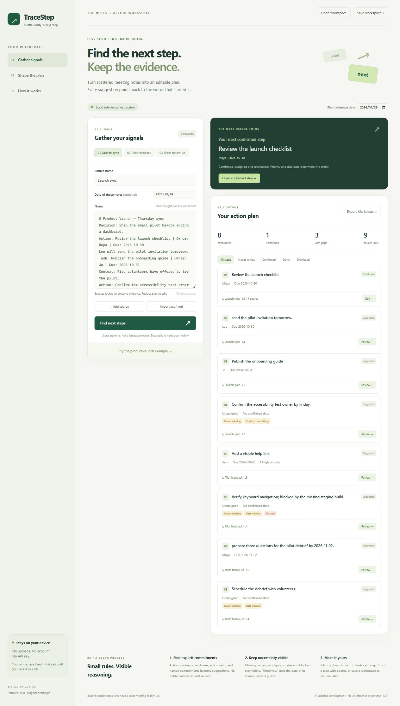

# TraceStep

**Find the next step. Keep the evidence.**

TraceStep turns scattered meeting notes into an editable, source-linked action plan. It is a small, original prototype for HackHoster's **Signal to Action — October 2026** challenge, built on October 29–30, 2026 (UTC / Asia–Shanghai).



## Try it in under a minute

1. Download and extract this project.
2. Open **`dist/index.html`** in a current Chrome, Edge or Firefox browser. There is no install, build, account or API key.
3. Click **Try the product-launch example**. The synthetic example contains three sources; it produces **8 action candidates and 9 evidence links**.
4. Review **Review the launch checklist**. Its two exact source quotes show why this duplicate became one action.
5. Click **Confirm step**. It now appears as the next confirmed step because it has an owner, a date and no blocker.
6. Review the accessibility-owner task. “Friday” remains unconfirmed; fill in an owner and an ISO date yourself.
7. Export Markdown, or save a JSON workspace and open it later. Both exports are files on your device.

If your browser restricts local-file scripts, use the optional preview: install Node.js 18 or later, run `npm start`, and open the printed loopback URL. This preview binds to `127.0.0.1`, selects an available port and stops automatically after ten minutes. Close it earlier with Ctrl+C. Runtime app dependencies: **zero**.

## Who it is for

A small team's meeting facilitator who has notes in a few text files and needs a credible follow-up. The problem is not a lack of another summary: it is knowing which commitment belongs to whom, which details are missing, and where the commitment came from.

TraceStep makes the transformation visible: **source line → candidate → human review → confirmed plan**. It does not create or send calendar events, emails or messages, and it does not execute tasks.

## What works

- Paste several sources or import UTF-8 `.txt` / `.md` files.
- Extract explicit actions, unchecked checkboxes, simple named commitments and supported action verbs.
- Preserve source title, source date, exact quoted line and line number for every candidate.
- Merge literal duplicate actions while keeping every source reference.
- Leave ambiguous dates and unknown owners unresolved. “Today” and “tomorrow” use the date of the individual source.
- Detect explicit blockers and high-priority labels.
- Edit, confirm, dismiss, restore and complete steps; filter the plan by state.
- Recommend a confirmed, assigned, dated, unblocked step. Suggestions are never automatically promoted to confirmed work.
- Export Markdown with evidence or a validated JSON workspace for round-trip editing.
- Work without network requests, analytics, cookies, local storage or paid APIs. Sources stay in tab memory until explicitly exported; refreshing without saving loses them.
- Includes responsive layout rules, keyboard-accessible controls, focus states and a native modal dialog. Desktop browser behavior was verified; small-screen runtime verification is still pending.

## Input conventions

One thought per line is the supported unit. For reliable results, use:

```text
Action: Review the launch checklist | Owner: Maya | Due: 2026-10-30
Leo will send the pilot invitation tomorrow.
@Maya prepare three questions for the debrief by 2026-11-02.
- [ ] Check the help link
Task: Verify keyboard navigation; blocked by the missing staging build.
```

`Action:`, `Action item:`, `Task:`, `TODO:` and unchecked checkboxes are explicit markers. Owner and due metadata use a pipe or semicolon separator. Explicit dates use `YYYY-MM-DD`. Priority can be `Priority: high`, `[high]`, `urgent`, `critical`, `P0` or `P1`.

`Decision:`, `Context:`, `Note:`, `Question:`, `Idea:`, `Maybe:` and `Consider:` lines are excluded. Checked boxes, `Done:`, `Completed:` and leading `Do not` / `Don't` / `Never` / `No need to` statements are excluded.

## Deliberate limits

This is **deterministic English-pattern extraction, not an AI model**. AI assisted development; it is not running inference on your notes. It does not understand arbitrary prose, infer implied commitments, recognize every negation or establish factual truth. A line beginning with a supported verb can still be a false positive; tasks phrased outside the supported patterns can be missed.

- One action per line is recommended; compound tasks are not split.
- English action patterns only. Non-English names in explicit owner metadata are preserved.
- No PDF, DOCX, OCR, calendar, mail or collaboration integration.
- Weekdays, numeric dates such as `11/02`, and “next week” require manual confirmation. Dates are calendar dates with no inferred timezone or time-of-day semantics.
- Duplicate merging is literal normalization, not semantic matching. Contradictory owners or due dates remain separate candidates; the app does not resolve conflicts automatically.
- Blockers are text flags; no dependency graph or automatic unblock action exists.
- The “next step” order is a transparent heuristic: confirmed status, blockers, priority, overdue status, ownership, dates, then date order. It is not a claim about the user's actual business priorities.
- Sources lock after extraction so evidence stays stable. **Find next steps → Replace plan** clears the current plan, unlocks sources, and lets you extract again. Save first to retain edits.
- Workspaces are limited to 20 sources, 100,000 characters per source, 300,000 source characters total, 1,000 candidates and 100 repeated evidence lines per candidate. Exceeding an extraction limit produces an error rather than silent truncation. Use smaller focused notes for practical review.
- Workspace files contain the original notes. The app does not upload them, but users should review exports before sharing them.

## Verification

Run `npm test` using Node.js 18+. No dependency installation is needed. The tests cover explicit provenance, relative dates at year boundaries, invalid dates, ambiguous dates, negative/completed lines, missing fields, duplicate handling, blockers, confirmation gating, prioritization, Markdown escaping, workspace integrity, multilingual owner fields and CRLF line numbering.

See [VALIDATION.md](VALIDATION.md) for the measured results and browser checks. Test fixtures are synthetic; no external user study, real-world accuracy benchmark or time-saving result is claimed.

## Files

| Path | Purpose |
| --- | --- |
| `dist/index.html`, `styles.css`, `app.js`, `engine.js` | Complete buildless app |
| `tests/engine.test.cjs` | Behavioral engine tests |
| `tools/serve.cjs` | Optional temporary local preview |
| `examples/` | Synthetic source notes and sample exports |
| `SUBMISSION.md` | Copy-ready English competition fields |
| `DEMO-SCRIPT.md` | Short judge walkthrough / recording script |
| `CREDITS.md`, `LICENSE` | AI disclosure, provenance and license |
| `COMPETITION.md` | Official challenge details and preparation status |

## Competition status

This project is a prepared entry. **A local package or a published repository is not an actual HackHoster submission.** As of October 30, 2026, the prepared project has not been submitted. The official [submission page](https://hackhoster.org/monthly/submission) requires a demo or accessible source, a walkthrough and credits. A saved draft is not a submission. The local preparation folder also retains a detailed `STATUS.json`; it is not part of the public source package.

## License

Original project code, prose and synthetic examples are MIT licensed. See [LICENSE](LICENSE) and [CREDITS.md](CREDITS.md). Official rules pages retained in local evidence are third-party reference material, not covered by the project's license.
